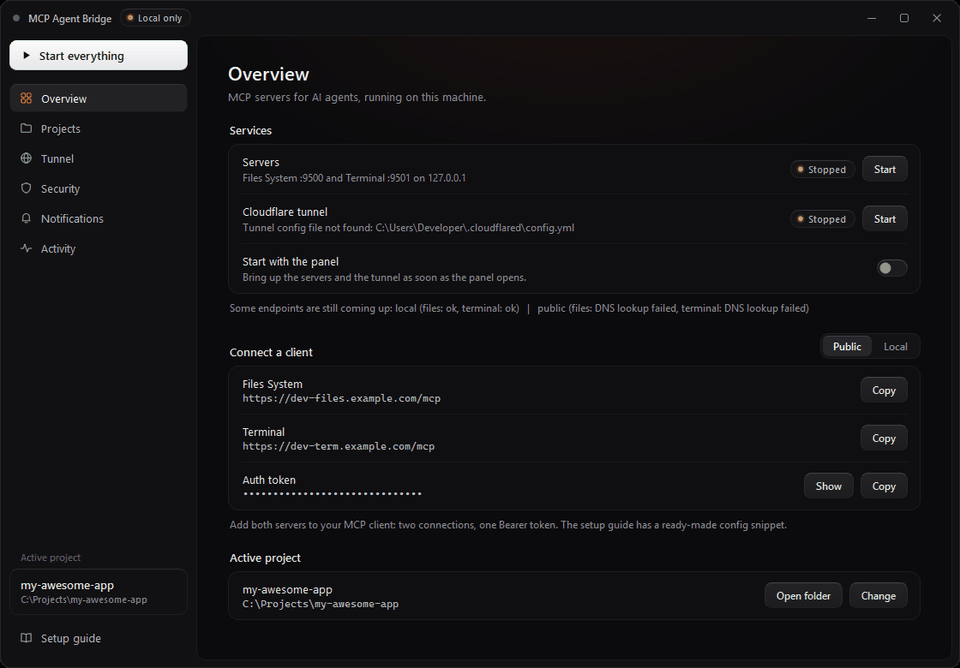
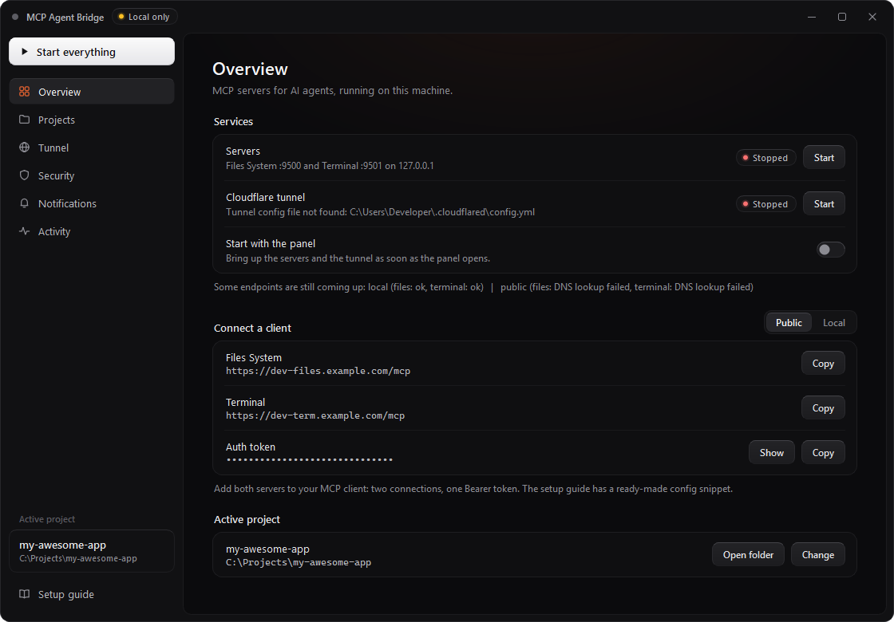
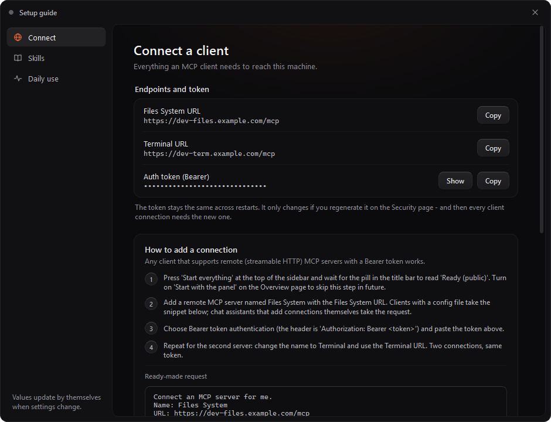
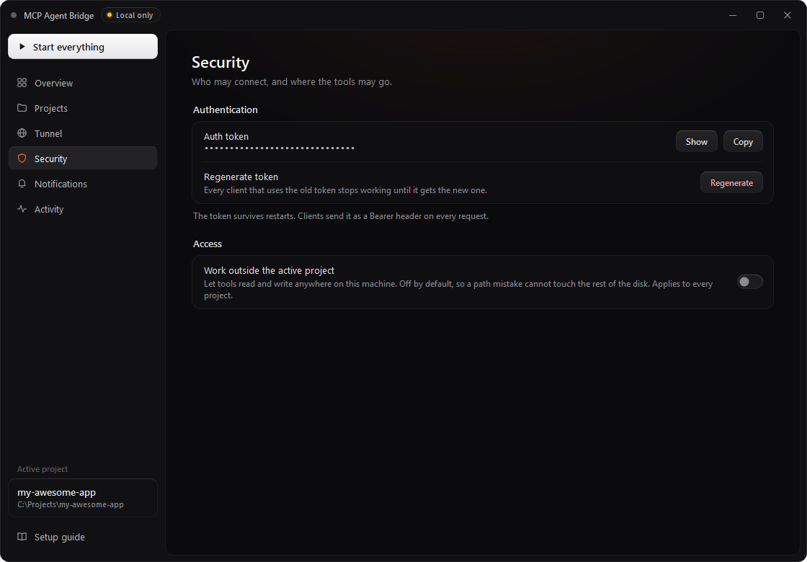
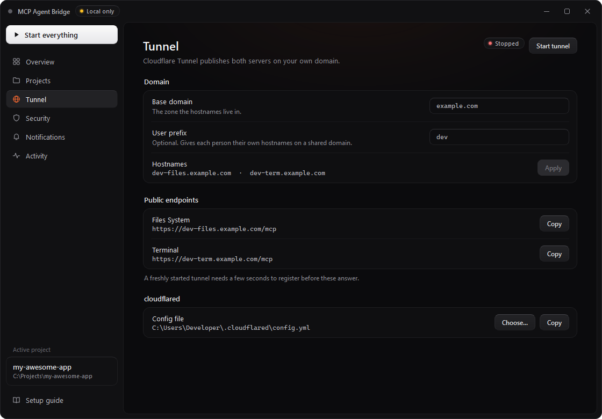

<div align="center">


# MCP Agent Bridge

**Give AI agents real hands on your Windows machine.**  
Dual streamable MCP servers for file system operations and terminal execution with token authentication, safety guards, undo history, and an optional Cloudflare Tunnel.

[](https://www.python.org/)
[](https://www.qt.io/)
[](https://modelcontextprotocol.io/)
[](https://microsoft.com/windows)
[](.github/workflows/ci.yml)
[](LICENSE)

</div>

---

## Overview

**MCP Agent Bridge** connects remote and local AI agents (such as Claude Code, Cursor, VS Code, or custom cloud agents) to your local Windows environment via two dedicated HTTP MCP servers:

- 📂 **Files System (`:9500`)**: Safe file reading (paged text, auto-image detection), editing with atomic replacements, file tree management, undo backups, and binary zip packing.
- ⚡ **Terminal (`:9501`)**: Command execution (`cmd.exe`), long-running background processes, stream monitoring with regex triggers, skill catalogs (`AGENTS.md`, `CLAUDE.md`, `npx skills`), and Telegram notifications.

Both servers feature single-token Bearer authentication, request rate limiting, project-scoped isolation, dangerous command blocking, and a native **PySide6 desktop control panel**.

For technical architecture details and design philosophy, see [ARCHITECTURE.md](ARCHITECTURE.md).

---

<details>
<summary><b>🎬 Visual Showcase (Interface Tour & Screenshots)</b></summary>
<br/>

<div align="center">
  
</div>

<br/>

| 🎛️ Control Panel (Overview) | ⚡ Fast Setup Guide |
|:---:|:---:|
|  |  |
| *Live port monitoring, status indicators & one-click start/stop* | *Ready-to-paste agent configurations for Claude, Cursor & IDEs* |

| 🛡️ Security Guardrails | 🌐 Cloudflare Tunnel Routing |
|:---:|:---:|
|  |  |
| *Accident guard, token regenerator & directory boundary checks* | *Effortless remote access ingress configuration* |

</details>

---

## Key Features

- 🛡️ **Accident Guard & Security**: Token-authenticated requests (`Authorization: Bearer <token>`), 20-failure IP rate limiting, project root containment, and hard-blocked catastrophic commands (`format`, `diskpart`, `shutdown`, app termination).
- 🔄 **Undo History**: Optional rollback history stored in `.mcp-backups/` allows instant reversion of modified or deleted files.
- 🌐 **Remote Tunnel Integration**: Built-in supervisor for Cloudflare Tunnel (`cloudflared`) to expose local servers over secure HTTPS subdomains for cloud agents.
- 🎯 **Zero Redundant Overhead**: Results sent once as clean plain text, avoiding FastMCP's duplicate structured payload and halving agent token costs.
- 📦 **Skills Ecosystem**: Discover and pack skills across bridge core, project definitions (`AGENTS.md`, `CLAUDE.md`, `GEMINI.md`), and installed tools.

---

## Supported Clients

Compatible with any MCP client supporting HTTP endpoints with Bearer authentication:
- **Claude Code**: Direct local connection (`http://127.0.0.1:9500/mcp`) or remote tunnel
- **Cursor & VS Code**: Remote agent tools integration
- **Web & Cloud Agents**: Custom connections over Cloudflare Tunnel
- Any custom MCP client or orchestration script

---

## Quick Start (Windows)

### 1. Prerequisites & Installation

1. Install **Python 3.10+** from [python.org](https://www.python.org/downloads/) (make sure to check **"Add python.exe to PATH"**).
2. Clone the repository and install requirements:
   ```cmd
   git clone git@github.com:Wolrym/mcp-agent-bridge.git
   cd mcp-agent-bridge
   pip install -r requirements.txt
   ```
3. *(Optional for remote clients)* Install **cloudflared**:
   ```cmd
   winget install Cloudflare.cloudflared
   ```

### 2. Launching the Control Panel

Generate desktop shortcuts with one command:
```cmd
python tools\make_shortcuts.py --desktop
```

- **MCP Agent Bridge**: Starts the GUI panel silently in the background (activity logged to `logs\bridge.log`).
- **MCP Agent Bridge (debug)**: Launches with an attached console for real-time tracebacks.
- You can also start via `start_gui.bat` or `python -m gui.app`.

### 3. Connect Your Agent

1. Launch the control panel and click **Start everything** in the sidebar.
2. Click **Setup guide** on the Overview page.
3. Copy your server endpoints, authentication Bearer token, and agent connection snippet directly into your MCP client (Claude Code, Cursor, custom agents).

---

## Headless CLI Mode

If you prefer running without the desktop GUI:

```cmd
python run_core.py                 :: servers + cloudflared tunnel
python run_core.py --no-tunnel     :: local HTTP servers only
python run_core.py --print-config  :: inspect tokens, ports, and endpoints
```

Manage configuration directly via CLI flags:
```cmd
python run_core.py --set-tunnel-config "C:\Users\<you>\.cloudflared\config.yml"
python run_core.py --domain example.com --user-slug alex
python run_core.py --enable-tunnel
python run_core.py --disable-tunnel
python run_core.py --enable-backups
python run_core.py --regenerate-token
```

> [!NOTE]
> Only one process can bind to ports 9500 and 9501 at a time. Do not run `run_core.py` and the GUI panel simultaneously.

---

## Tools Reference

### 📂 Files System (`http://127.0.0.1:9500/mcp`)

| Tool | Description |
|:---|:---|
| `read_file` | Paged text reading (`offset`/`limit`). Image formats (PNG/JPEG/GIF/WebP) return directly as image media. |
| `read_multiple_files` | Reads multiple files concurrently in a single tool call. |
| `write_file` | Creates or overwrites files while preserving line endings and byte-order marks (BOM). |
| `edit_file` | Precise snippet replacement (`replace_all`, `dry_run`). Rejects non-UTF-8 targets to prevent corruption. |
| `list_directory` | Lists directory contents with item limits. |
| `get_file_info` | Retrieves comprehensive file metadata and timestamps. |
| `search_files` | Glob search skipping ignore directories (`.git`, `node_modules`, etc.). |
| `grep` | Fast regex text search across project files. |
| `create_directory` | Creates directory hierarchies. |
| `move_file` | Moves or renames files and folders with backup tracking. |
| `delete_file` | Deletes files with undo support. |
| `list_changes` | Displays historical file modification records. |
| `undo_change` | Rolls back a specific modification using `.mcp-backups/`. |
| `pack_files` | Zips and base64 encodes files or folders for transfer to agent sandboxes. |
| `unpack_files` | Extracts base64 zip archives into the target workspace. |

### ⚡ Terminal (`http://127.0.0.1:9501/mcp`)

| Tool | Description |
|:---|:---|
| `run_command` | Executes commands through `cmd.exe`. Waits up to 45s before backgrounding and returning a process job ID. |
| `start_process` | Spawns long-running dev servers, background workers, or build processes. |
| `wait_process` | Awaits process completion or until standard output matches a regex (`until`). |
| `get_output` | Reads process console output (supports pagination and `tail`). |
| `stop_process` | Terminates a process and its full process sub-tree. |
| `list_processes` | Lists all active and recent background process jobs. |
| `get_active_project` | Returns the active project directory and permission boundaries. |
| `list_skills` | Discovers available skills from core, project rules (`AGENTS.md`, `CLAUDE.md`), and `npx skills`. |
| `get_skill` | Retrieves detailed instructions and commands for a specific skill. |
| `notify_user` | Sends a Telegram completion alert to the user. |

---

## Security Model

- 🔑 **Full PC Control**: `run_command` operates under user privileges. Keep the Bearer token secure. Regenerate it immediately if exposed.
- 🚦 **Brute-Force Rate Limiting**: 20 failed token attempts within 5 minutes triggers a 15-minute IP ban (HTTP 429). Supports `CF-Connecting-IP` behind Cloudflare.
- 🔒 **Accident Guard**: Blocks system destruction commands (`format`, `diskpart`, `shutdown`, root deletion) and process killers targeting the app or its tunnel.
- 📁 **Project Isolation**: Restricts file modifications strictly within the active project directory unless explicitly overridden by `security.allow_outside_project`.
- 🛡️ **Protected Settings**: Prevents connected agents from tampering with `config/settings.json`.

---

## Configuration

Settings are saved in `config/settings.json` (auto-generated on initial launch). Recommended adjustments:

| Parameter | Default | Description |
|:---|:---:|:---|
| `limits.command_timeout` | `45` | Execution wait threshold before backgrounding (seconds) |
| `limits.max_output_chars` | `100000` | Output character truncation ceiling |
| `limits.max_read_lines` | `900` | Default line limit for `read_file` |
| `limits.max_image_bytes` | `5000000` | Maximum image size returned inline (bytes) |
| `limits.max_pack_mb` | `25` | Maximum archive payload size (MB) |
| `servers.session_idle_seconds` | `900` | Automatic cleanup threshold for idle MCP sessions |
| `security.allow_outside_project` | `false` | Allow file tools to traverse outside project root |
| `security.block_dangerous_commands` | `true` | Prevent destructive system commands |
| `backups.enabled` | `false` | Enable snapshot backups for undo operations |

---

## Cloudflare Tunnel Setup

Expose your servers to remote agents using `cloudflared`:

```cmd
cloudflared tunnel login
cloudflared tunnel create mcp-agent-bridge
cloudflared tunnel route dns mcp-agent-bridge files.example.com
cloudflared tunnel route dns mcp-agent-bridge term.example.com
```

Configure `config.yml`:
```yaml
tunnel: mcp-agent-bridge
credentials-file: C:\Users\<you>\.cloudflared\<tunnel-id>.json
ingress:
  - hostname: files.example.com
    service: http://localhost:9500
  - hostname: term.example.com
    service: http://localhost:9501
  - service: http_status:404
```

---

## Running Tests

Run the test suite to verify tool integrity and authentication:

```cmd
python tests\smoke_test.py     :: Server HTTP verification, auth & tool manifests
python tests\tools_test.py     :: FastMCP tool behavior verification
python tests\jobs_test.py      :: Background process management
python tests\backups_test.py   :: File undo and backup history
python tests\test_notifier.py  :: User notifications
```

---

## Contributing & License

Contributions, issues, and feature suggestions are welcome! Please review [CONTRIBUTING.md](CONTRIBUTING.md) before submitting pull requests.

Distributed under the [MIT License](LICENSE).
